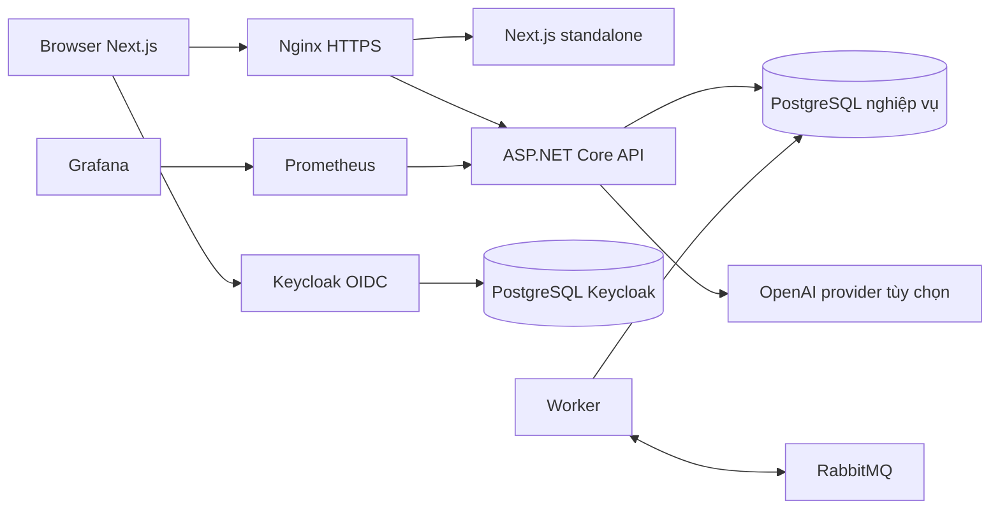
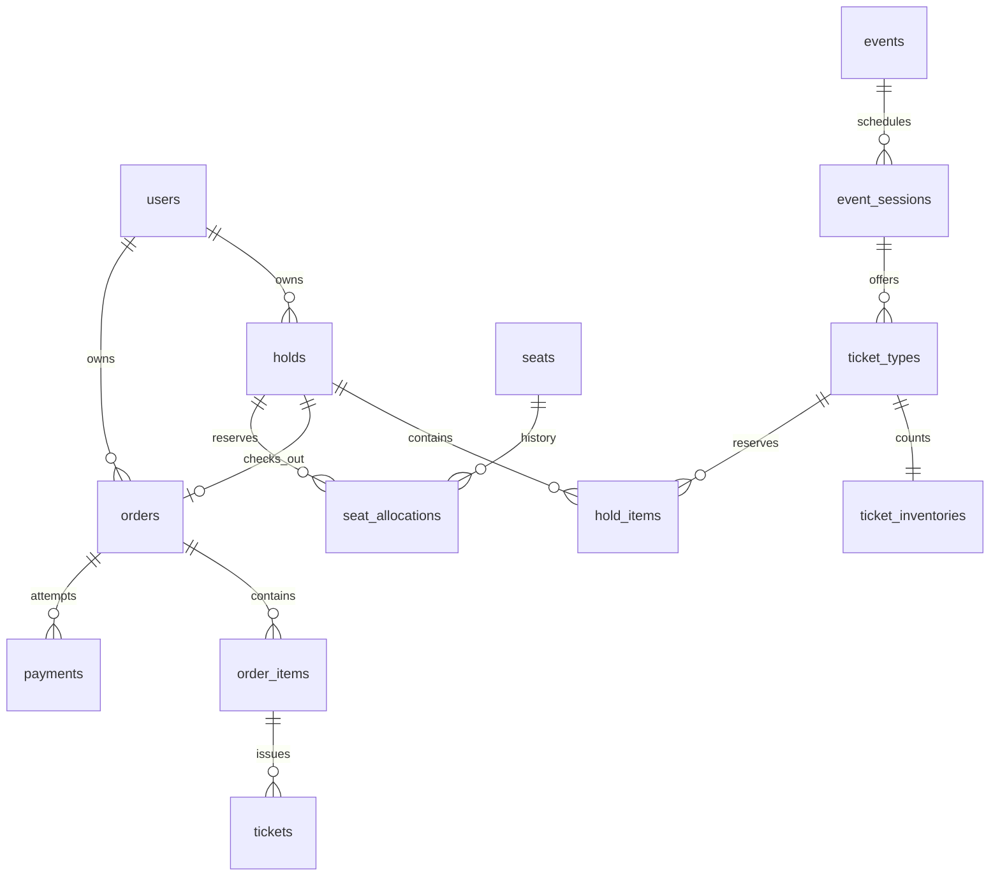
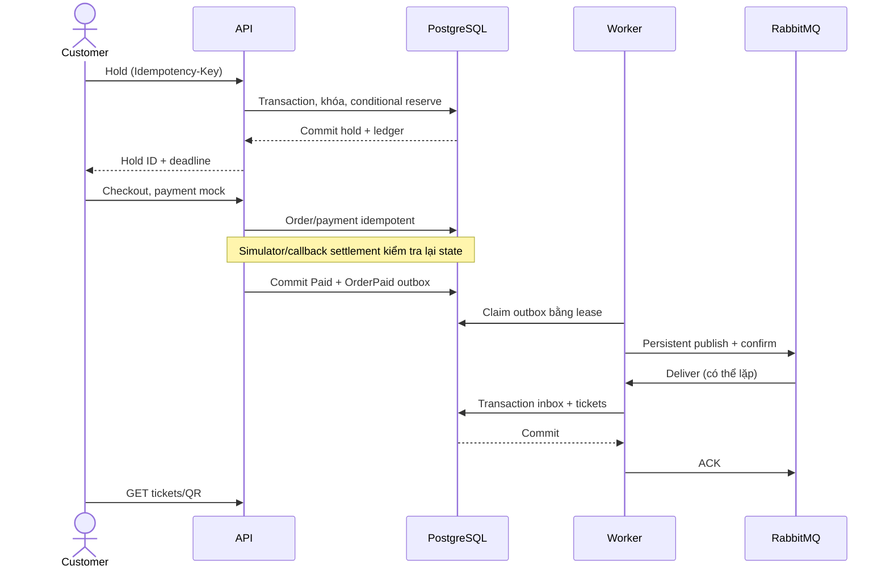
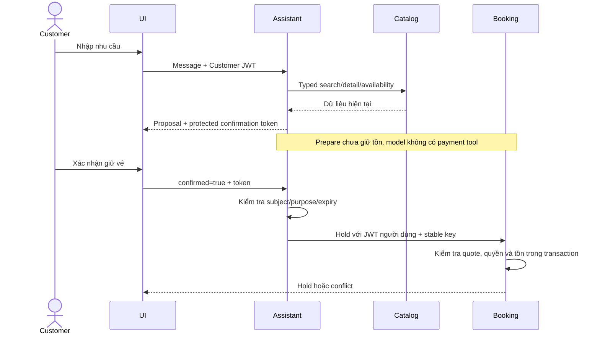

# Sơ đồ hiện trạng

Các sơ đồ rút gọn phục vụ thuyết trình, không thay schema đầy đủ. Tên bảng đối chiếu `database/init/001_initial_schema.sql` và migrations 002–011. Hạ tầng production là cấu hình đã chuẩn bị, chưa phải sơ đồ một VPS đã nghiệm thu.

## Hình 1 — Thành phần và ranh giới dữ liệu

Nguồn: `docker-compose.production.yml`, `src/TixFlow.Api/Program.cs`, Worker. Redis nằm trong stack nhưng không quyết định inventory; cache catalog metadata hiện tại thuộc process, generation invalidation qua PostgreSQL. Keycloak có hostname riêng qua Nginx; các mũi tên browser/auth là luồng logic, không có nghĩa public cổng container.

## Hình 2 — ERD nghiệp vụ rút gọn

Outbox, inbox, idempotency, audit và projection không vẽ để giữ hình dễ đọc. Một ghế có nhiều allocation lịch sử nhưng chỉ một allocation Held/Sold theo unique index. Cardinality minh họa không biểu diễn hết constraint về trạng thái, TTL hoặc ownership.

## Hình 3 — Payment và phát hành vé

Nguồn: Orders module, [phase 7](../phase-7-worker-tickets.md). Expiry chạy riêng trong Worker, khóa và kiểm tra trạng thái trước hoàn tồn; không phụ thuộc broker đang sẵn sàng.

## Hình 4 — Assistant và sự xác nhận

Nguồn: `AssistantModule.cs`, `AssistantTokens.cs`, `AssistantBookingApi.cs`, Booking module. Nếu giá thay đổi trả `QUOTE_CHANGED`; nếu provider không sẵn sàng, UI hướng về catalog.
