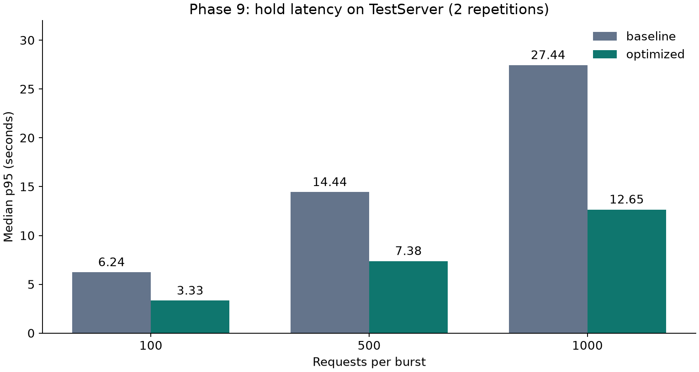
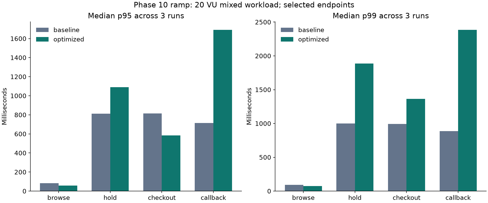

# TixFlow — Thiết kế, triển khai và thực nghiệm hệ thống đặt vé

Bản thảo kỹ thuật phục vụ khóa luận · 24/10/2026 · review candidate.

Bản này tổng hợp implementation và bằng chứng trong repository. Chưa bổ sung thông tin tác giả, mẫu trình bày của trường, tổng quan nghiên cứu học thuật hoặc xác nhận của giảng viên. Các kết quả chưa nghiệm thu được ghi rõ; không trình bày setup VPS như một hệ thống đã vận hành thực tế.

## Tóm tắt

TixFlow triển khai luồng đặt vé nhiều sự kiện với hai dạng tồn kho: vé theo số lượng và ghế cố định. Bài toán chính là giữ đúng lượng vé khi có yêu cầu cạnh tranh, retry, thanh toán và tác vụ hết hạn diễn ra đồng thời. Hệ thống sử dụng PostgreSQL để quyết định trạng thái nghiệp vụ, API ASP.NET Core, Worker bất đồng bộ, frontend Next.js và Keycloak. Assistant hỗ trợ tìm kiếm/đề xuất nhưng cần người dùng xác nhận trước khi gọi Booking API.

Regression tại mốc bàn giao đạt 106/106 test. Trong thực nghiệm TestServer phase 9, median p95 của burst 1.000 request giảm từ khoảng 27,44 giây xuống 12,65 giây; mỗi mức tải chỉ lặp hai lần. Thực nghiệm HTTP phase 10 cho thấy kết quả không đồng đều: một số endpoint cải thiện p95 nhưng hold/callback có độ trễ đuôi tăng. Ba profile smoke/ramp/spike có 18 run đạt; soak lỗi nên toàn chiến dịch chưa hoàn tất. Kết quả hỗ trợ đánh giá implementation trong cấu hình đã đo, chưa chứng minh SLA hoặc năng lực production.

## Chương 1 — Bài toán và phạm vi

Người mua cần xem sự kiện, chọn suất diễn/loại vé/ghế, giữ chỗ trong thời gian giới hạn và hoàn thành thanh toán. Nhiều khách có thể chọn cùng ghế hoặc mua lượng vé cuối cùng. Mất kết nối có thể khiến client gửi lại yêu cầu đã được server commit. Callback thanh toán và Worker hết hạn cũng có thể chạy đồng thời. Vì vậy, chỉ kiểm tra số vé trên UI hoặc cache không đủ để đảm bảo tính đúng.

Các mục tiêu được cụ thể hóa thành invariant: số vé giữ và bán không vượt capacity; mỗi ghế chỉ có một allocation hoạt động; retry không nhân đôi hold/order/settlement; cancel/expiry không hoàn tồn hai lần; sự kiện phát hành trùng không sinh thêm vé. Authorization phải gắn với người dùng và đối tượng, không chỉ phụ thuộc việc ẩn nút trên frontend.

Phạm vi hiện tại gồm catalog/quản trị, OIDC, inventory, hold, checkout, payment mock, expiry, outbox/RabbitMQ, vé QR/check-in, Assistant và bộ triển khai VPS. Payment và notification là mô phỏng; không tuyên bố tích hợp cổng thu tiền hoặc email thật. Các màn hình prototype còn dùng mock được phân biệt với API đã triển khai. Chưa có kết luận về 10.000 người dùng đồng thời, waiting room hoặc khả năng mở rộng đa vùng.

Nguồn yêu cầu: [use case](../phase-1-actors-and-use-cases.md), [business rules](../phase-1-business-rules.md). Đây là thiết kế ban đầu; các chương sau sử dụng implementation và báo cáo theo phase để xác định phần đã làm.

## Chương 2 — Phân tích và thiết kế

Hệ thống được tổ chức theo modular monolith. API tập trung nghiệp vụ đồng bộ; Worker xử lý hết hạn, chuyển tiếp outbox và phát hành vé. Cách chia này cho phép kiểm soát transaction đặt vé trong một database, đồng thời đưa công việc có thể xử lý sau ra khỏi request. Không yêu cầu một mạng microservice để hoàn thành giao dịch giữ chỗ.

PostgreSQL lưu user, event/session, ticket type/inventory, seat/allocation, hold, order/payment và ticket. Hold ghi snapshot giá và thời hạn để các bước tiếp theo có căn cứ ổn định. Idempotency ledger lưu scope, user, key và hash payload; cùng key/payload trả lại kết quả đã commit, khác payload bị từ chối. Các bảng outbox/inbox bổ sung ranh giới tin cậy giữa transaction dữ liệu và message delivery.

Catalog metadata có cache riêng theo process và generation trong PostgreSQL để vô hiệu hóa; availability đọc dữ liệu hiện tại. Redis không phải khóa quyết định bán vé. Rate limiter API hiện theo process; Nginx áp dụng giới hạn ở gateway. Khi tăng replica, không được suy ra quota global từ một limiter local. Xem [kiến trúc](../architecture.md) và [Hình 1–4](diagrams.md).

Keycloak cấp JWT, API kiểm tra audience/role và trạng thái người dùng. Customer đọc giao dịch của mình, Organizer quản trị/check-in theo sự kiện sở hữu, Admin có quyền hỗ trợ được giới hạn/audit ở các route liên quan. Token frontend được giữ trong memory; không đưa client secret vào biến public.

## Chương 3 — Triển khai các luồng chính

### Giữ chỗ và checkout

Booking khóa tài nguyên theo thứ tự ổn định, kiểm tra lại trạng thái mở bán và dùng conditional update để reserve inventory. Reserved seating có unique constraint cho allocation hoạt động. Nhiều item trong một hold được xử lý all-or-nothing; không để lại giữ một phần khi item sau thất bại. Deadline dựa trên thời gian PostgreSQL sau khi lấy khóa.

Cancel/expiry là chuyển trạng thái có điều kiện. Chỉ aggregate đang hoạt động mới giải phóng tồn. Checkout tạo order từ hold hợp lệ và giữ snapshot; thanh toán mock và callback có idempotency riêng. Race với expiry được giải quyết trong transaction và kiểm tra lại trạng thái, không dựa vào đồng hồ browser. Nguồn: [phase 5](../phase-5-hold-concurrency.md), [phase 6](../phase-6-checkout-payments.md), [tối ưu phase 9](../phase-9-optimization.md).

### Phát hành vé và phục hồi lỗi

Settlement thành công ghi `OrderPaid` vào outbox cùng transaction. Publisher claim có lease, gửi persistent message và chờ broker confirm trước khi đánh dấu đã phát. Consumer dùng inbox và uniqueness theo đơn vị OrderItem để giữ tính idempotent khi redelivery; ACK xảy ra sau commit. Đây là xử lý delivery có thể lặp cùng hiệu ứng nghiệp vụ idempotent, không phải một tuyên bố mạng gửi đúng một lần.

Vé QR dùng key riêng và kiểm tra ownership/state trước khi trả dữ liệu. Database và key volume cần được backup cùng bộ; chỉ restore database không đảm bảo đọc/kiểm tra được vé cũ. Poison message và retry/DLQ có quy trình xử lý, không xóa inbox để thử lại tùy tiện. Nguồn: [phase 7](../phase-7-worker-tickets.md).

### Assistant có xác nhận

Assistant có bốn typed tool: tìm event, đọc detail, đọc availability và chuẩn bị hold. Proposal chưa reserve inventory. Confirmation token được bảo vệ bằng Data Protection, gắn với subject, purpose và expiry; UI yêu cầu `confirmed: true`. Booking kiểm tra lại giá/tồn trong transaction nên model không quyết định giá hoặc bỏ qua authorization. Không có tool thanh toán, check-in hoặc đọc order tùy ý.

Timeout/provider error trả fallback và đường quay về catalog. Test sử dụng transport giả lập để kiểm tra biên quyền, tool invocation, token và replay; không chứng minh độ chính xác tiếng Việt hay khả năng chống prompt injection của model thật. Tập 20 case đã chuẩn bị nhưng còn cần chạy provider thật và chấm tay. Nguồn: [phase 11](../phase-11-ai-assistant.md), [evaluation cases](../evaluation/phase11-cases.json).

## Chương 4 — Phương pháp thực nghiệm

Ba nhóm bằng chứng được tách riêng. Regression kiểm tra quy tắc chức năng bằng Testcontainers. Phase 8/9 đo burst giữ chỗ bằng TestServer trong runner cùng CPU với bộ phát tải. Phase 10 dùng k6 qua HTTP/Nginx trong Docker Desktop với monitoring tài nguyên/database/queue. Không gộp số liệu các nhóm vì transport, nguồn tải và workload khác nhau.

Phase 9 so sánh image baseline đã xác minh source hash với bản tối ưu, cùng dataset và giới hạn tài nguyên. Có sáu burst: 100, 500, 1.000 request, mỗi mức hai lần; mỗi burst có 50 vé, mỗi request một vé, warm-up riêng. Pool 40, một API, runner 2 CPU/2 GiB. Cả baseline và optimized ghi tổng 3.200 request, 300 tạo hold, 2.900 hết capacity, oversold bằng 0 trong các run. Đây là kiểm tra cạnh tranh theo fixture, không tương đương 1.000 người dùng có think time trên mạng.

Phase 10 dùng protocol `http-load-v3`, dataset `load-v2`, ba lần cho mỗi variant/profile. Ramp có 20 VU, spike 100 VU cho scenario mixed; smoke có các scenario đồng thời với tham số 10 VU mỗi scenario; không ghi smoke là tổng 10 VU. Soak dự kiến 10 VU giữ 30 phút nhưng chiến dịch bị ngắt. Một API giới hạn 2 CPU/1 GiB, load generator 2 CPU/1 GiB, pool 40, rate limiting tắt trong phép so sánh. Cùng host Docker Desktop làm tài nguyên chia sẻ và không đại diện VPS.

Latency được tính từ các điểm custom `endpoint_latency` trong `raw.json.gz`, loại setup. Percentile tính trong từng run rồi lấy median giữa run cùng variant/endpoint. Rate là số request endpoint chia cửa sổ đo toàn workload; không phải công suất tối đa độc lập của endpoint. Chỉ run có `passed=true` mới vào bảng so sánh đạt. Bản tổng hợp kiểm tra cấu hình/harness và image trong cùng variant nhất quán. Raw và SHA-256 được lưu để truy ngược. Nguồn: [script tổng hợp](../../scripts/Summarize-Phase10.py), [runbook](../phase-10-load-testing.md).

## Chương 5 — Kết quả và thảo luận

### Độ đúng và TestServer

Regression mới đạt **106/106**, failed 0, skipped 0; nguồn `artifacts/phase13/verification/phase13-regression.trx`. Kết quả này cho biết các test hiện có đạt ở môi trường đã chạy; không bao quát mọi race có thể có hoặc thay thế nghiệm thu browser.

Tại 1.000 request/burst, median throughput từ khoảng 35,33 lên 76,38 request/s và p95 từ 27,44 xuống 12,65 giây. Loại bỏ điểm khóa độc quyền metadata trên đường giữ vé là thay đổi được đo trong phase 9; số mẫu hai lần không đủ để khẳng định khoảng tin cậy hoặc tính ổn định dài hạn. Bảng đầy đủ nằm ở [measured-results](measured-results.md); JSON nguồn là `reference-concurrency.json` và `concurrency.json` trong `docs/reports/optimized-v1/`.

### HTTP và giới hạn của tối ưu

Ramp cho thấy browse p95 giảm khoảng 82,39 xuống 58,54 ms, checkout p95 giảm 814,82 xuống 584,83 ms. Tuy nhiên hold p95 tăng 811,21 lên 1.090,09 ms; callback p95 tăng 715,50 lên 1.692,33 ms. Checkout p99 cũng tăng từ khoảng 992,54 lên 1.365,36 ms. Vì mixed workload chia sẻ tài nguyên và số giao dịch xử lý thay đổi, không kết luận một thay đổi khóa là nguyên nhân duy nhất nếu chưa phân tích monitoring tương ứng.

Đã có 6 spike, 6 smoke, 6 ramp đạt k6/invariant trong chiến dịch ngày 22/10. Run soak đầu tiên lỗi `Load database SQL failed.`; log dịch vụ cho thấy PostgreSQL không còn chạy tại thời điểm kiểm tra, nhưng nguyên nhân dừng chưa được kết luận. Không có sáu run soak hoàn chỉnh; trạng thái campaign vẫn failed. Chưa dùng số liệu này để chốt SLO, công bố toàn campaign đạt hoặc quyết định waiting room đã không cần thiết.

### Triển khai và phục hồi

Phase 12 đã chuẩn bị Compose production, reverse proxy HTTPS, cấu hình Keycloak, monitoring, migration ledger/checksum, backup/restore drill và rollback image. Fixture đã qua bảy nhóm kiểm tra, gồm migration mới, replay, từ chối checksum sai, rollback SQL lỗi, backup/restore, invariant và restart persistence. Restore database fixture 77.935 byte mất 1,281 giây. Đây là kết quả fixture PostgreSQL cách ly, chưa đo DNS/TLS, login, key recovery và toàn thời gian khôi phục dịch vụ. Các image Linux đã build ở phase 12; chưa deploy VPS theo yêu cầu người dùng.

## Chương 6 — Hạn chế và hướng hoàn thiện

Đóng góp hiện có là một luồng đặt vé có kiểm soát cạnh tranh, retry và message redelivery; hệ thống test/evidence gắn với source; phép so sánh thuật toán có baseline; Assistant gọi API có xác nhận; bộ vận hành có migration/backup/rollback. Bằng chứng được lưu cùng hạn chế thay vì chỉ chọn các biểu đồ cải thiện.

Ưu tiên tiếp theo là điều tra soak bị ngắt, chạy lại các profile theo cùng protocol và xem độ trễ đuôi của hold/callback. Sau đó thực hiện đánh giá AI thật với tiêu chí chấm rõ ràng; nghiệm thu login/payment/ticket và phục hồi DB + keys trên VPS khi người dùng cấu hình hạ tầng. Chỉ chốt release khi source của cả hai repo có commit sạch, image digest tương ứng, CI đạt và người khác tái tạo được từ hướng dẫn.

Các hướng nghiên cứu sau nghiệm thu gồm admission control/waiting room dựa trên SLO, rate limit tổng nhiều replica và kiểm thử trên host tải tách riêng. Chúng là hướng mở, không được đưa vào danh sách tính năng đã triển khai. Tài liệu này còn cần tác giả bổ sung tổng quan học thuật, quy chuẩn trích dẫn và mẫu trường trước khi nộp chính thức.

## Phụ lục — Truy vết

| Khẳng định | Bằng chứng gốc |
|---|---|
| 106 test đạt | `artifacts/phase13/verification/phase13-regression.trx` |
| So sánh burst phase 9 | `docs/reports/optimized-v1/reference-concurrency.json`, `concurrency.json`, manifests |
| HTTP smoke/ramp/spike | Các batch `20261022T*` được chỉ rõ trong `evidence-summary.json`; raw, manifest, invariant, result |
| Soak chưa đạt | `artifacts/phase10/campaign-20261022T131923523Z/status.json`, `20261022T140340222Z-soak/baseline-1/result.json` |
| Fixture restore | `artifacts/phase12/deployment-integration.json` |
| API hiện tại | `openapi.json`, `openapi-provenance.json`, source `Modules/` |
| Snapshot bàn giao | `REVIEW-MANIFEST.json` bên trong ZIP; HEAD + dirty flag + hash từng file |

Tài liệu phase trước là nguồn dự án có ngày, không phải tài liệu tham khảo học thuật. Các hướng dẫn công nghệ bên ngoài đã dẫn trong runbook tương ứng cần được tác giả kiểm tra/chuẩn hóa trích dẫn khi hoàn thiện bản nộp.
