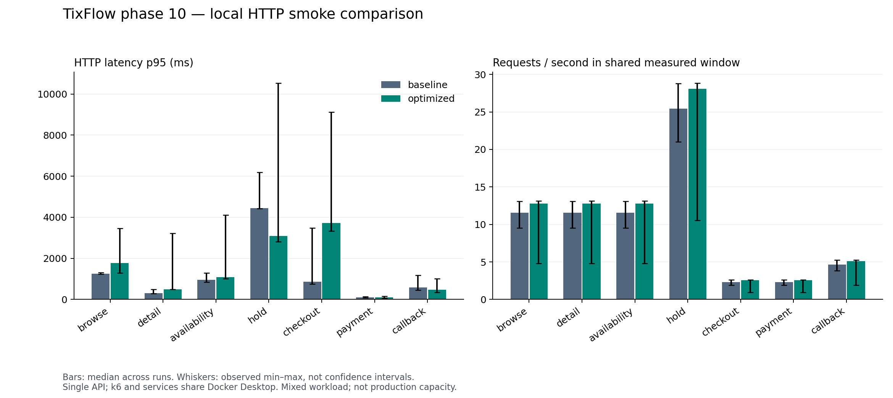

# Phase 10 — kết quả HTTP smoke đầu tiên

Ngày **19/10/2026**, Asia/Saigon. Batch `20261019T124834680Z-smoke`: **6/6 run đạt**, baseline và optimized mỗi bản ba lần. Tất cả invariant bằng 0 lỗi; đây là kết quả tính đúng dưới workload đã chạy, chưa phải nghiệm thu toàn bộ phase 10 hoặc xác nhận SLO.

Mỗi run: 50 VU tối đa trong 5 scenario chạy đồng thời, 420 iteration nghiệp vụ và 731 HTTP request được đo (không tính setup). Gồm browse/search/detail, availability, tranh 50 vé, tranh 1 ghế và 20 checkout. Cả sáu run đều có đúng 50 hold quantity, 1 hold ghế, 10 payment Succeeded, 10 Failed và 10 vé phát hành. Lỗi kỹ thuật/429 bằng 0, 149 conflict hết vé/ghế dự kiến mỗi run. Retry hold/order/payment giữ nguyên ID; callback được xử lý đúng một lần về mặt nghiệp vụ.

## Kết luận hiệu năng có giới hạn

Median p95 Hold giảm **4437 → 3093 ms** trong workload hỗn hợp này. Tuy nhiên median p95 Checkout tăng **871 → 3715 ms**; Browse cũng tăng **1260 → 1777 ms**. Không kết luận mọi endpoint đều nhanh hơn. Checkout giữ khóa metadata độc quyền còn Hold dùng khóa chia sẻ là một hướng cần điều tra; bộ số liệu ngắn này chưa chứng minh đó là nguyên nhân.

Độ dao động lớn: p95 Hold optimized từ 2807 đến 10538 ms, Checkout từ 3338 đến 9117 ms. Các scenario cạnh tranh cùng session/CPU; warm-up có catalog và hold/cancel nhưng checkout/payment vẫn có chi phí lần gọi đầu. Host Docker Desktop dùng chung với máy làm việc và chưa có time series CPU của k6 trong batch này. Vì vậy cần đo dài hơn, thu đủ monitoring và chốt SLO trước khi nghiệm thu hay đề xuất Waiting Room. Runner hiện tại đã bổ sung lấy mẫu cả container k6; không áp dụng ngược số đo đó cho batch cũ.

[Bảng đầy đủ](comparison.md), [CSV từng endpoint/run](endpoints.csv), [JSON tổng hợp và invariant](aggregate.json), [biểu đồ SVG](comparison.svg). Whisker là min–max thực đo, không phải confidence interval.

## Nguồn và tái tạo

- `baseline-1` đến `baseline-3`: image phase 8 đối chiếu 107 hash với manifest gốc.
- `optimized-1` đến `optimized-3`: image phase 9 đối chiếu 120 hash với manifest gốc.
- Mỗi thư mục có manifest, raw k6 gzip, summary, cấu hình, DB/resource samples, query statistics, queue snapshot và invariant/result. Không chứa JWT hoặc QR signing key.
- `harness/` giữ đúng input đã băm của batch smoke này, gồm runner trước cải tiến lấy mẫu k6. Các hash trong manifest phải khớp file tương ứng tại `harness/`. Để tái chạy đúng harness, copy các đường dẫn tương ứng vào một checkout riêng của backend rồi chạy runner; không chạy script ngay trong thư mục báo cáo vì nó xác định repository bằng đường dẫn cha.
- [Runbook phase 10](../../phase-10-load-testing.md) mô tả cấu hình, dataset, giới hạn, câu lệnh và các cổng còn mở. Bản baseline/optimized dùng cùng cấu hình single API/pool40, Redis không tham gia, rate limit tắt; optimized bật cache. DB tmpfs và issuer test không đại diện VPS, TLS hoặc Keycloak login.

Không thay thuật toán sau khi đo để gắn lại nhãn cho số liệu cũ. Nếu tối ưu tiếp Checkout, tạo phiên bản thí nghiệm mới và so lại trên cùng workload.

## Kiểm chứng profile spike của runner

Run `20261019T125750660Z-optimized-1`, profile spike **20 VU**, hoàn thành **609 iteration** trong 51s tải theo stages, chưa gồm setup. Mỗi iteration browse/detail, đọc availability, giữ vé, replay và hủy. Threshold và toàn bộ invariant đều đạt, lỗi kỹ thuật/429 bằng 0. Bộ sampler mới đã ghi CPU/RAM của container k6 trong 9 snapshot. [Manifest](spike-validation/manifest.json), [summary](spike-validation/summary.json), [invariant](spike-validation/invariants.json), [kết quả](spike-validation/result.json).

Đây là kiểm chứng bổ sung một lượt của profile và collector, không gộp vào so sánh smoke ba lần, không phải thử 10.000 VU hoặc kết quả admission control (limiter vẫn tắt). Chưa chạy đủ ramp/soak, chưa có Grafana snapshot hay SLO chính thức.
